# Games Collection


### Lokal in Entwicklung: Entdecken / Aktuell beliebt

Auf `feature/popscore` zeigen Web und Android im eigenen Reiter **Entdecken** bis zu 100 nach IGDB-Aufrufen beliebte Titel. „+ Hinzufügen“ öffnet den Editor; die Sammlung und ihre Filter bleiben getrennt. Der neue Serverendpunkt `/api/discover` benötigt die vorhandenen Twitch-/IGDB-Zugangsdaten. Rangliste täglich im Serverprozess gecached; keine zusätzliche Konfiguration oder Datenbankmigration. Dieser lokale Stand ist noch nicht veröffentlicht. Details: [PopScore](design/popscore/README.md).

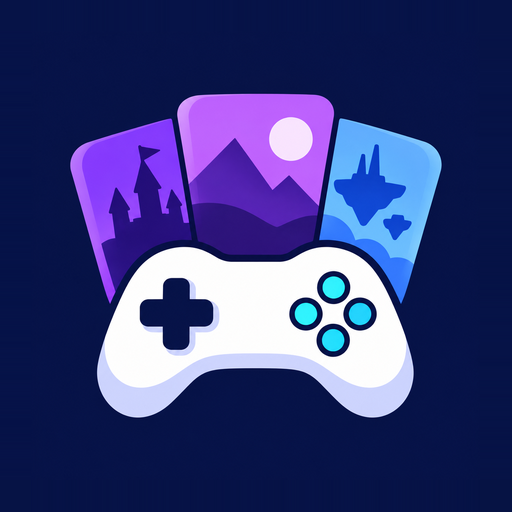

Games Collection ist eine selbst gehostete Webanwendung zur Verwaltung einer persönlichen Videospielesammlung. Spieldaten und Cover erfolgen über die Suche von IGDB. Die Anwendung bietet zwei Designs, Filter, Statistiken, Benutzerkonten und eine installierbare PWA-Oberfläche.

Dank Docker Container ist die Einrichtung einfach.

## Einblicke in die Webanwendung

Die Sammlung im Browser mit den Designs **Cinematic Dark** und **Editorial Shelf**:

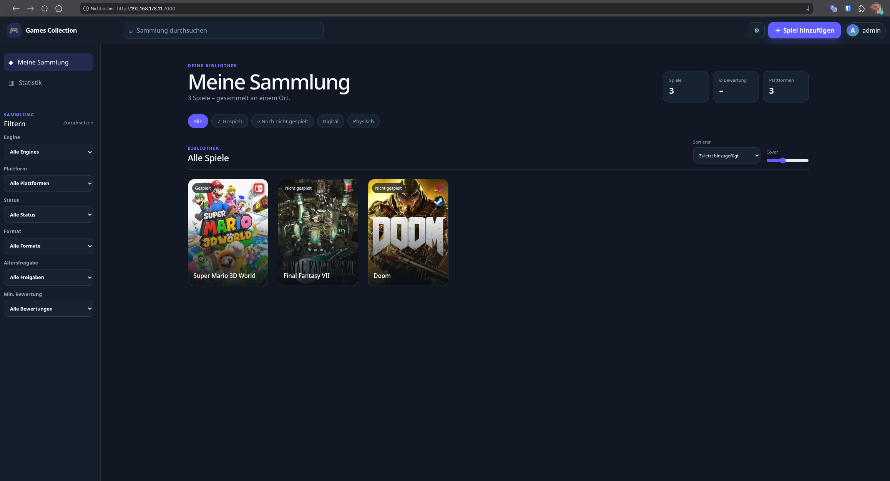

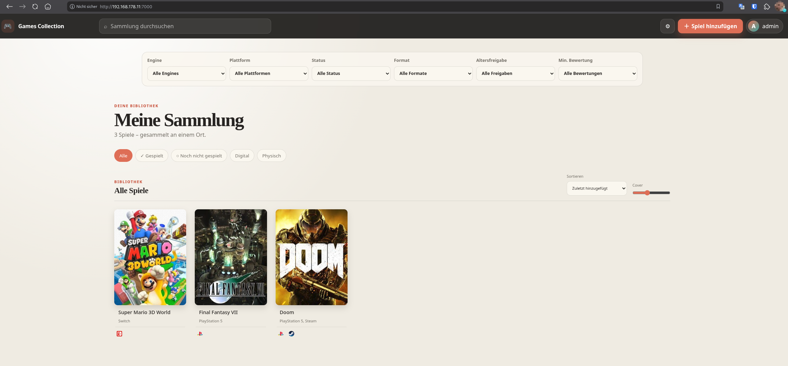

Anmeldung, Spielverwaltung mit IGDB-Daten und Sammlungsstatistik:

| Anmeldung | Spiel hinzufügen | Statistik |
| --- | --- | --- |
| 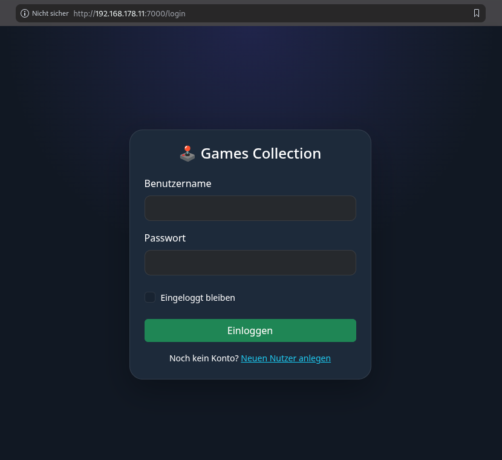 | 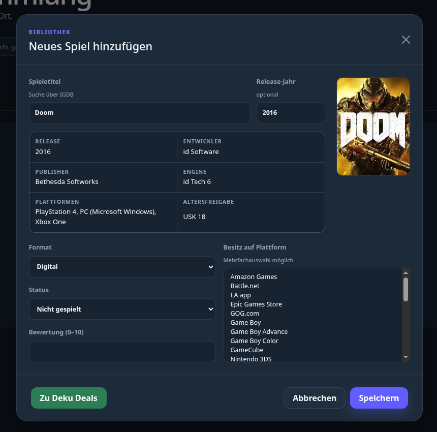 | 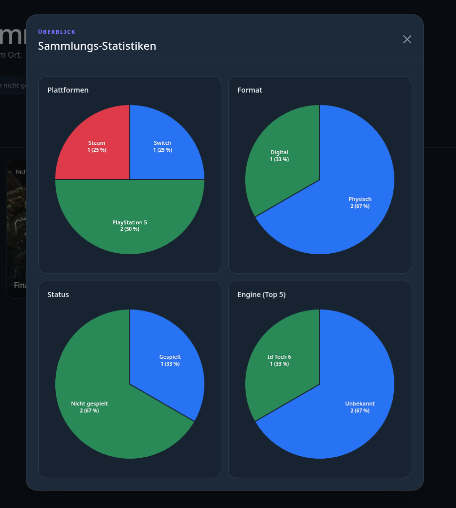 |

## Voraussetzungen

- Docker Engine
- Docker Compose (optional)
- Twitch-/IGDB-Zugangsdaten für die Spielesuche

## Einrichtung

1. Beispieldatei für die Konfiguration kopieren:

   ```bash
   cp .env.example .env
   ```

2. Die Werte in `.env` entsprechend dem Abschnitt [Konfiguration](#konfiguration) eintragen.

3. Fertiges Image aus der GitHub Container Registry laden und starten:

   ```bash
   docker compose pull
   docker compose up -d
   ```

4. `http://localhost:7000` öffnen. Der zuerst angelegte Benutzer erhält Administratorrechte.

Die SQLite-Datenbank wird im lokalen Verzeichnis `data/` abgelegt.

## Docker-Image und Updates

**Server-Release 0.8:** [Release Notes](release-notes/server-0.8.md), Tag `docker-v0.8`, Image `ghcr.io/mehmet-b-90/games_collection:0.8`. PopScore wird nach dem Merge auf `main` auch über `latest` bereitgestellt, sobald dessen Docker-Workflow erfolgreich abgeschlossen ist.

Das Server-Image liegt unter `ghcr.io/mehmet-b-90/games_collection`. Es unterstützt `linux/amd64` (übliche PCs/Server) und `linux/arm64` (beispielsweise ARM-NAS und Raspberry Pi mit 64-Bit-System). Docker wählt die passende Architektur automatisch.

```bash
docker pull ghcr.io/mehmet-b-90/games_collection:latest
```

Für eine feste Server-Version den Eintrag `image:` direkt in `docker-compose.yaml` auf `ghcr.io/mehmet-b-90/games_collection:0.8` setzen. Das Image lässt sich auch separat herunterladen:

```bash
docker pull ghcr.io/mehmet-b-90/games_collection:0.8
```

`latest` folgt dem zuletzt erfolgreich veröffentlichten Serverstand von `main`. Mit der mitgelieferten Compose-Datei aktualisierst du eine bestehende Installation so:

```bash
docker compose pull
docker compose up -d
```

Die vorhandene `.env` und das eingebundene Verzeichnis `data/` werden weiterverwendet. Vor Updates eine Sicherung der SQLite-Datenbank erstellen; eine laufende SQLite-Datenbank mit WAL nicht durch bloßes Kopieren nur der Datei `database.db` sichern.

Der Container läuft standardmäßig mit UID/GID `1000:1000`. Das eingebundene `data/` muss für diesen Benutzer schreibbar sein. Bei einer Neuinstallation das Verzeichnis vorher anlegen und passende Besitzrechte setzen. Auf SELinux-Systemen wie Fedora kann für den Bind-Mount zusätzlich `./data:/app/data:Z` erforderlich sein.

### Lokal aus dem Quellcode bauen

Für eigene Änderungen zuerst den Eintrag `image:` in `docker-compose.yaml` auf `games-collection:local` setzen und anschließend das lokale Image bauen und starten:

```bash
docker build -t games-collection:local .
docker compose up -d --pull never
```

Der Docker-Buildkontext enthält ausschließlich Dockerfile, `requirements.txt` und die Anwendung unter `files/`. Lokale Konfiguration, Datenbank, Git-Verlauf und Android-Werkzeuge werden nicht an den Builder übertragen.

## Konfiguration

Die Anwendung liest ihre Konfiguration aus der Datei `.env`. Die Datei enthält Geheimnisse und darf deshalb nicht in das Repository aufgenommen oder öffentlich weitergegeben werden.

```env
SECRET_KEY=ein-langer-zufaelliger-wert
TWITCH_CLIENT_ID=deine-twitch-client-id
TWITCH_CLIENT_SECRET=dein-twitch-client-secret
SESSION_COOKIE_SECURE=false
```

### Flask-Schlüssel

`SECRET_KEY` gehört zur lokalen Flask-Anwendung und **nicht** zur IGDB-API. Flask verwendet diesen Wert, um unter anderem Sitzungs-Cookies und CSRF-Tokens kryptografisch zu signieren. Dadurch kann der Server erkennen, ob diese Werte nachträglich verändert wurden.

Für jede Installation sollte ein eigener, langer und zufälliger Schlüssel verwendet werden. Mit Python lässt sich ein geeigneter Wert so erzeugen:

```bash
python3 -c "import secrets; print(secrets.token_hex(32))"
```

Alternativ kann OpenSSL verwendet werden:

```bash
openssl rand -hex 32
```

Beide Befehle erzeugen 32 kryptografisch sichere Zufallsbytes und geben sie als 64 Hexadezimalzeichen aus. Der ausgegebene Wert wird anschließend ohne Anführungszeichen hinter `SECRET_KEY=` in die `.env`-Datei eingetragen.

Wird `SECRET_KEY` bei einer laufenden Installation geändert, werden bestehende Benutzersitzungen ungültig und die Benutzer müssen sich erneut anmelden.

### IGDB-Authentifizierung

IGDB verwendet die Anwendungsverwaltung und OAuth-Authentifizierung von Twitch. Für die Spielesuche benötigt Games Collection daher genau zwei Zugangsdaten einer registrierten Twitch-Anwendung:

- `TWITCH_CLIENT_ID`: die öffentliche Kennung der registrierten Anwendung
- `TWITCH_CLIENT_SECRET`: das geheime Kennwort der Anwendung

Ein Twitch- oder IGDB-Benutzername und das persönliche Kontopasswort werden **nicht** benötigt und dürfen nicht in `.env` eingetragen werden.

Beim ersten Zugriff auf die Spielesuche sendet der Server Client-ID und Client-Secret an den OAuth-Dienst von Twitch. Mit dem OAuth-Verfahren `client_credentials` erhält er ein zeitlich begrenztes Access-Token. Anschließend sendet Games Collection dieses Token zusammen mit der Client-ID an IGDB. Das Token wird vorübergehend im Arbeitsspeicher zwischengespeichert und nach Ablauf automatisch neu angefordert.

```text
Client-ID + Client-Secret
          │
          ▼
    Twitch OAuth
          │
          ▼
zeitlich begrenztes Access-Token
          │
          ▼
       IGDB API
```

Die Client-ID und das Client-Secret können nach der Registrierung einer Anwendung im [Twitch Developer Portal](https://dev.twitch.tv/console/apps) erzeugt werden. Weitere Details beschreibt die [IGDB-API-Dokumentation](https://api-docs.igdb.com/).

### Sichere Cookies

`SESSION_COOKIE_SECURE` bestimmt, ob der Browser das Sitzungs-Cookie ausschließlich über HTTPS übertragen darf:

- `false`: für lokale Tests über `http://localhost:7000`
- `true`: für den produktiven Betrieb über HTTPS, beispielsweise hinter Caddy

Für eine öffentlich oder im Netzwerk erreichbare Installation mit HTTPS sollte der Wert auf `true` gesetzt werden.

## Fehlerdiagnose im Serverbetrieb

Bei Datenbank- oder unerwarteten Serverfehlern zeigt die Anwendung eine deutsche Meldung mit Fehler-ID. Dieselbe ID steht im Betreiber-Log; API-Antworten enthalten zusätzlich `request_id` und den Header `X-Request-ID`.

```bash
docker compose logs --since=30m games_collection
```

Im Log nach der gemeldeten ID suchen. Datenbankfehler liefern HTTP 503; Schreibkonflikte liefern 409 und erfordern einen erneuten Abruf des Datensatzes. SQL-Parameter werden in Datenbank-Tracebacks ausgeblendet. Die Ergebnisse und Grenzen der aktuellen Prüfung stehen in [SERVER_REVIEW.md](SERVER_REVIEW.md).

## Android-App

[Android-App 0.8 direkt als APK herunterladen](https://github.com/mehmet-b-90/games_collection/releases/download/android-v0.8/Games-Collection-0.8-release.apk)

Die Android-App wird als signierte Release-APK bereitgestellt und unterstützt Android 8.0 oder neuer. Bei der Installation muss gegebenenfalls die Installation aus dieser Quelle zugelassen werden. Für die Verbindung benötigt der Server die JSON-API dieser Projektversion.

Seit **20.10.2026** ist Version **0.7 / Code 4** zusätzlich in einem **internen Google-Play-Test** aktiv; eine öffentliche Store-Veröffentlichung ist noch nicht erfolgt. Der Test ist nur für ausgewählte Google-Konten über den Teilnahme-Link verfügbar. Status und nächste Schritte stehen in [Google Play](android/PLAY_STORE.md).

Die Play-Version verwendet auf Wunsch einen Google-App-Signaturschlüssel und kann die bisherige direkt verteilte Release-APK nicht unmittelbar aktualisieren. Vor einem bewussten Installationswechsel alle ausstehenden Offline-Änderungen synchronisieren und den [Signaturhinweis](android/README.md#google-play-und-bisherige-release-apks) beachten.

Im Ordner [`android/`](android/README.md) liegt eine eigenständige native Android-App mit Kotlin und Jetpack Compose. Sammlung, Filter, Statistik, Anmeldung und Spielverwaltung werden direkt in der App dargestellt. Die App kommuniziert per JSON-API mit dem Docker-Server; eine WebView wird nicht verwendet. Die beiden Designs Cinematic Dark und Editorial Shelf stehen auch nativ zur Verfügung. Vor der ersten Verbindung muss der Server auf das Image dieser Projektversion aktualisiert werden. Hinweise zur Installation, zum APK-Build und zu HTTPS stehen in der [Android-Anleitung](android/README.md).

Der aktuelle Android-Quellstand enthält zusätzliche Stabilitätskorrekturen für Entwürfe, HTTP-Abbruch und große Sammlungen. Für sicheres Wiederholen von Spieländerungen muss auch der Server aktualisiert werden; er ergänzt eine Tabelle für Vorgangsbelege. Version 0.7 enthält diese Korrekturen, die Offline-Sammlung und direkte IGDB-Suche. Für die Tokenbereitstellung den Server auf diesen Quellstand aktualisieren. Beim Wechsel von einer Debug-APK den Signaturhinweis in der Android-Anleitung beachten.

### Einblicke in die Android-App

Anmeldung, Sammlung, IGDB-Suche, Spielverwaltung und Statistik auf dem Smartphone. Die Vorschaubilder lassen sich für die vollständige Ansicht öffnen.

| Anmeldung | Sammlung | IGDB-Suche |
| --- | --- | --- |
| <a href="docs/screenshots/android-login.jpg">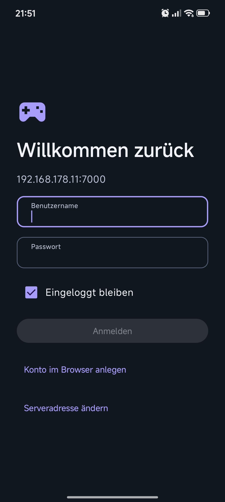</a> | <a href="docs/screenshots/android-sammlung.jpg">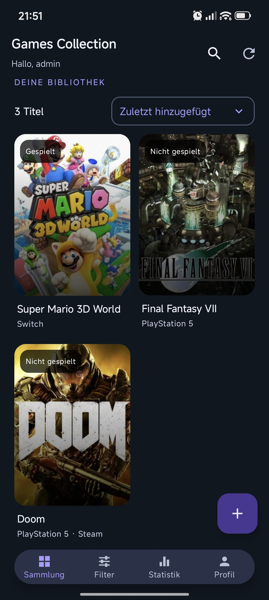</a> | <a href="docs/screenshots/android-igdb-suche.jpg">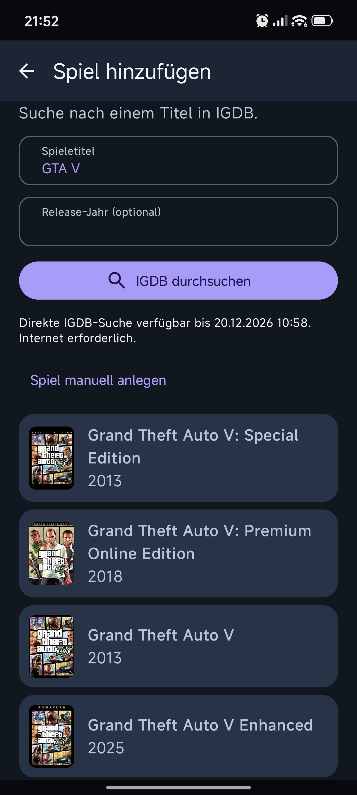</a> |

| Spiel hinzufügen | Statistik |
| --- | --- |
| <a href="docs/screenshots/android-spiel-hinzufuegen.jpg">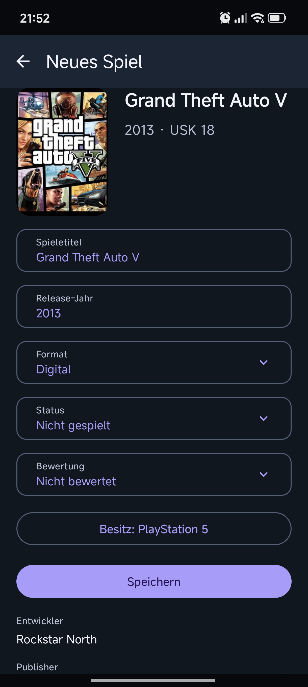</a> | <a href="docs/screenshots/android-statistik.jpg">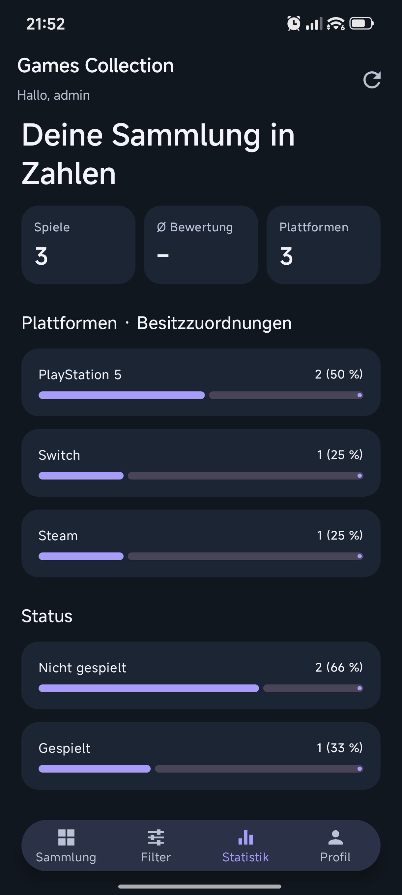</a> |

## Technischer Aufbau

- Flask und Gunicorn
- SQLAlchemy mit SQLite
- Bootstrap sowie modulares JavaScript
- Docker Compose
- PWA mit Service Worker und Web-App-Manifest

### Künftige Server-Releases

Seit 25.10.2026 lösen Tags nach `server-v<VERSION>` (z. B. `server-v0.9`) die Server-Veröffentlichung aus. Bestehende `docker-v*`-Tags bleiben unverändert. Release Notes werden aus [der Vorlage](release-notes/TEMPLATE.md) als `release-notes/server-<VERSION>.md` angelegt: Titel „Games Collection v<VERSION>“, Abschnitt „Neue Funktion“; das veröffentlichte Image mit Digest ergänzt der Workflow. Neue GitHub Releases erhalten das Label **Latest**. Dieses Label ändert nicht das Docker-Image-Tag `latest`, das weiterhin `main` folgt.
