# Games Collection

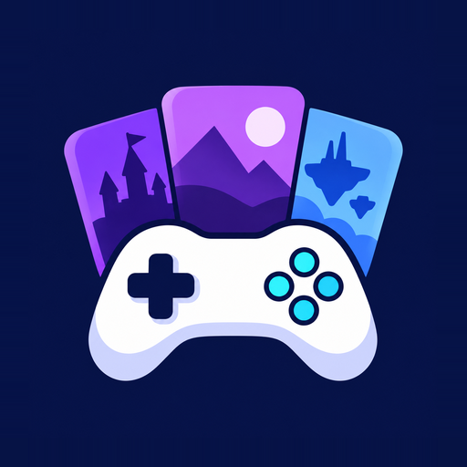

Games Collection verwaltet deine Videospielesammlung auf einem eigenen Server. Die Webanwendung und die native Android-App greifen auf dasselbe Konto und dieselbe Sammlung zu.

- **Web** · Im Browser nutzbar und als Web-App installierbar. Spiele mit Besitzplattformen, Status und Bewertung verwalten, die Sammlung filtern und Statistiken ansehen.
- **Android** · Native App mit Kotlin und Jetpack Compose. Die eigene Sammlung bleibt offline verfügbar. Änderungen werden lokal vorgemerkt und können später synchronisiert werden.
- **In beiden Apps** · Die Designs **Cinematic Dark** und **Editorial Shelf**, Spielesuche mit Daten und Covern von IGDB, beliebte Spiele unter **Entdecken** und Lesefreigabe für bestätigte Freunde. Mit Web bzw. Android ab Version 0.10 kommen eigene Cover und kontoweite Vorgaben für neue Spiele hinzu.

**Neue lokale Erweiterung:** Einzelne [Exemplare pro Spiel](docs/EXEMPLARE.md) mit Plattform, Format und optionaler Ausgabe in Web und Android. Noch nicht veröffentlicht; vor einem Update den dort beschriebenen datenerhaltenden Migrationsweg beachten.

Der lokale Web-Stand ist **0.11**. Unter **Einstellungen → Info** steht die Version des verbundenen Webservers.

Games Collection wurde mit Unterstützung von OpenAI Codex entwickelt.

## Server mit Docker einrichten

Du brauchst **Docker mit Docker Compose**, einen Host mit **AMD64 oder ARM64**, einen freien Host-Port **7000** (Compose-Standard) und für die IGDB-Spielesuche und **Entdecken** Zugangsdaten einer Twitch-Anwendung.

### 1. Twitch-Anwendung für IGDB registrieren

Melde dich mit einem Twitch-Konto mit aktivierter Zwei-Faktor-Authentifizierung im Entwicklerportal an. Registriere eine Anwendung mit dem Client-Typ **Confidential**. Für das Pflichtfeld der OAuth-Weiterleitungsadresse genügt eine localhost-Adresse wie `http://localhost`. Öffne anschließend die Verwaltung der Anwendung, kopiere die **Client ID** und erzeuge ein **Client Secret**. Der Server verwendet beide Werte, um automatisch ein Zugriffstoken abzurufen. [Twitch Developer Portal](https://dev.twitch.tv/console/apps) · [IGDB-Anleitung](https://api-docs.igdb.com/#account-creation)

### 2. Konfiguration anlegen

```bash
git clone https://github.com/mehmet-b-90/games_collection.git
cd games_collection
cp .env.example .env
mkdir -p data
openssl rand -hex 32
```

Öffne `.env` und trage die erzeugte Zeichenfolge als `SECRET_KEY` ein. Sie dient der Anwendung zum Signieren von Sitzungen und CSRF-Tokens. Übernimm die Twitch-Werte in die beiden übrigen Zugangsfelder. Halte `.env` privat.

```dotenv
SECRET_KEY=hier-den-zufallswert-eintragen
TWITCH_CLIENT_ID=hier-die-client-id-eintragen
TWITCH_CLIENT_SECRET=hier-das-client-secret-eintragen
SESSION_COOKIE_SECURE=false
```

Für lokale HTTP-Tests bleibt `SESSION_COOKIE_SECURE=false`. Für den öffentlichen Betrieb stelle HTTPS über einen Reverse-Proxy bereit und setze `SESSION_COOKIE_SECURE=true`. Der Container benötigt Schreibzugriff auf `./data` (standardmäßig UID/GID `1000:1000`). Auf SELinux-Systemen kann für den Bind-Mount `./data:/app/data:Z` nötig sein.

### 3. Starten und Konto anlegen

```bash
docker compose pull
docker compose up -d
docker compose ps
```

Compose lädt `ghcr.io/mehmet-b-90/games_collection:latest`. Öffne [http://localhost:7000](http://localhost:7000) direkt auf dem Server oder verwende von einem anderen Gerät die erreichbare Serveradresse. Das erste registrierte Konto erhält Administratorrechte. Die SQLite-Datenbank bleibt in `./data/database.db` erhalten.

### Updates und Backups

Erstelle vor einem Update ein konsistentes Datenbank-Backup. Ab Server 0.10 findest du den Export unter **Serververwaltung → Datenbank exportieren**. Führe danach erneut `docker compose pull` und `docker compose up -d` aus. Verwende dieselbe `.env` und dasselbe `data/`-Verzeichnis weiter. Prüfe anschließend `/health`, die Anmeldung und deine Sammlung.

[Server-Release 0.10](https://github.com/mehmet-b-90/games_collection/releases/tag/server-v0.10) · [Wiederherstellung, lokale Builds und Fehlerdiagnose](docs/SERVER_BETRIEB.md)

## Android-App installieren

1. Die [signierte Android-App 0.9 als APK herunterladen](https://github.com/mehmet-b-90/games_collection/releases/download/android-v0.9/games_collection-v0.9.apk) und auf einem Gerät mit Android 8.0 oder neuer installieren.
2. In der App die vom Smartphone erreichbare URL deines Games-Collection-Servers eingeben und dich mit deinem Web-Konto anmelden.

[Android-Anleitung und APK-Build](android/README.md) · [Interner Google-Play-Test](android/PLAY_STORE.md)

## Screenshots

### Webanwendung

Die Sammlung im Browser mit den Designs **Cinematic Dark** und **Editorial Shelf**:

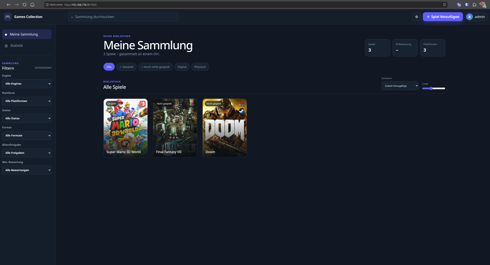

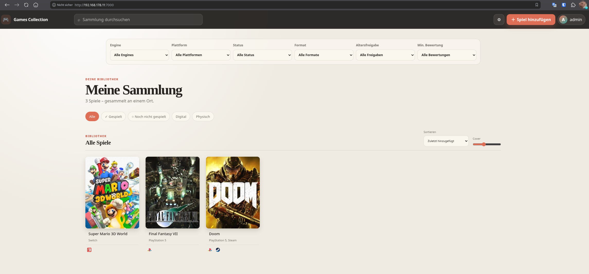

Anmeldung, Spielverwaltung mit IGDB-Daten und Sammlungsstatistik:

| Anmeldung | Spiel hinzufügen | Statistik |
| --- | --- | --- |
| 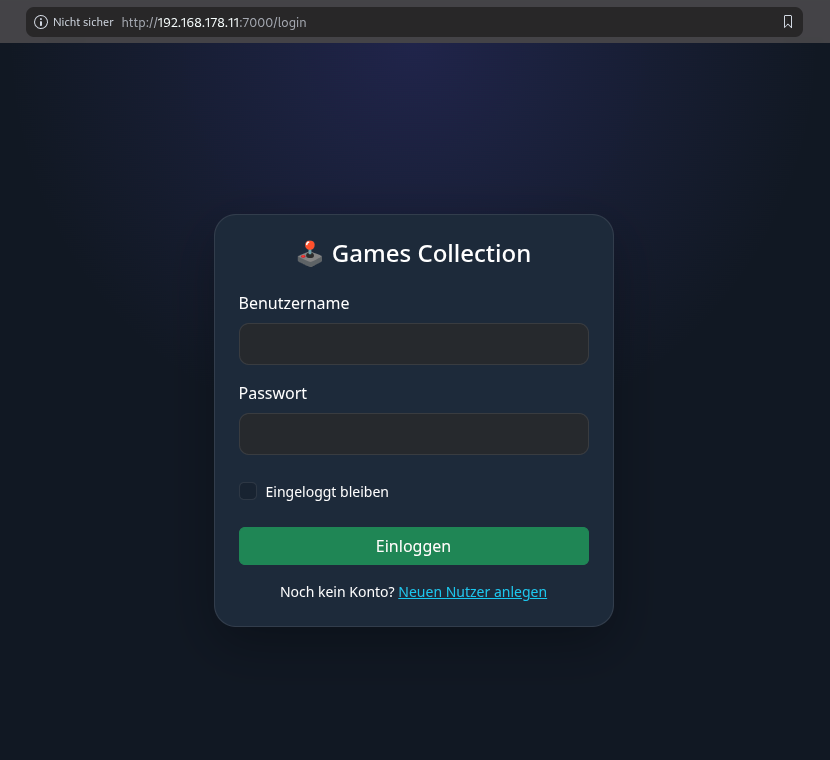 | 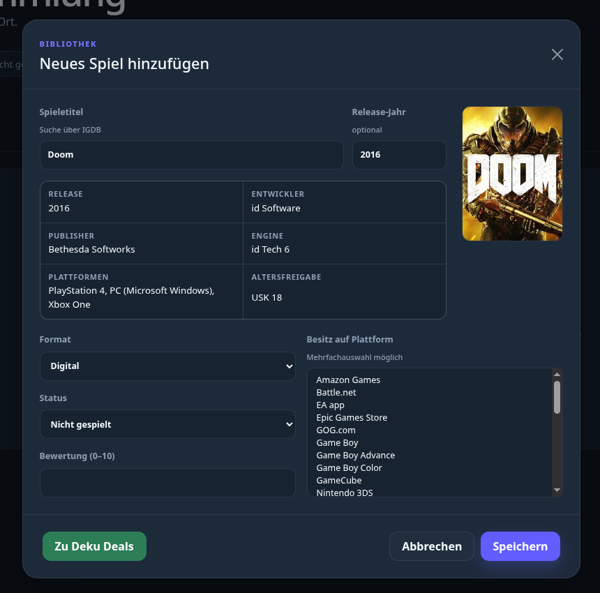 | 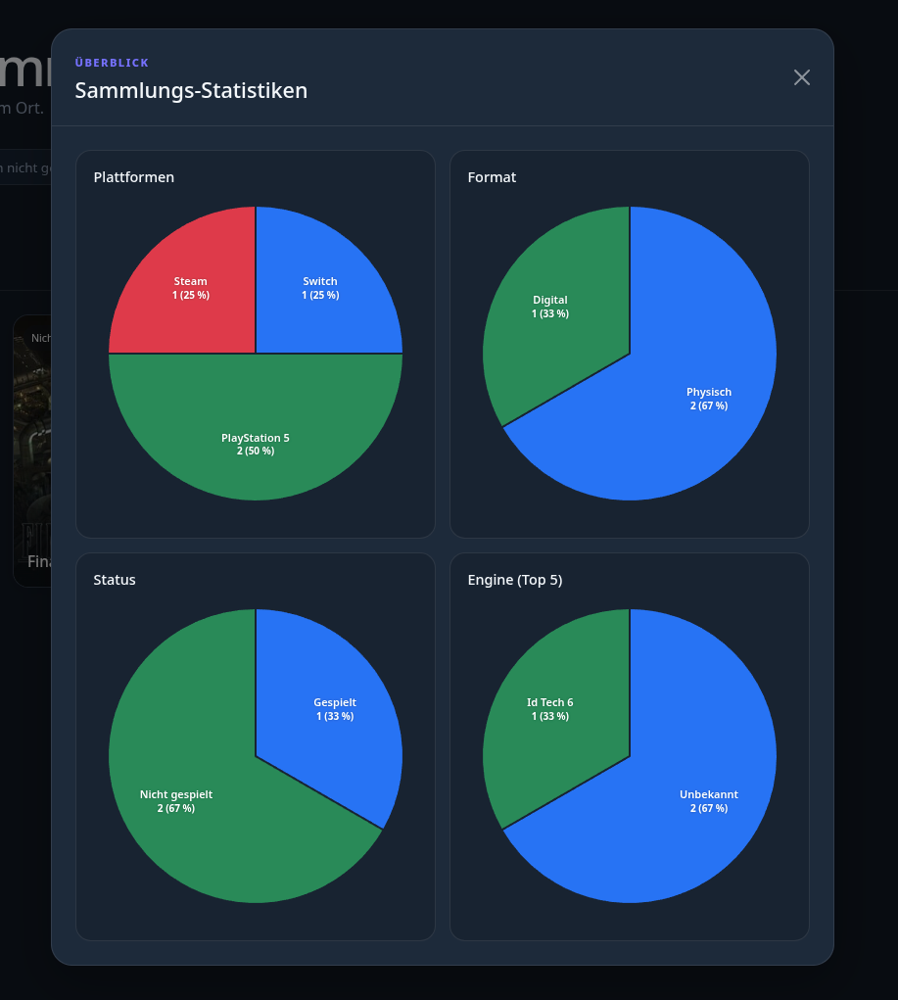 |

### Android-App

Anmeldung, Sammlung, IGDB-Suche, Spielverwaltung und Statistik auf dem Smartphone. Die Vorschaubilder lassen sich für die vollständige Ansicht öffnen.

| Anmeldung | Sammlung | IGDB-Suche |
| --- | --- | --- |
| <a href="docs/screenshots/android-login.jpg">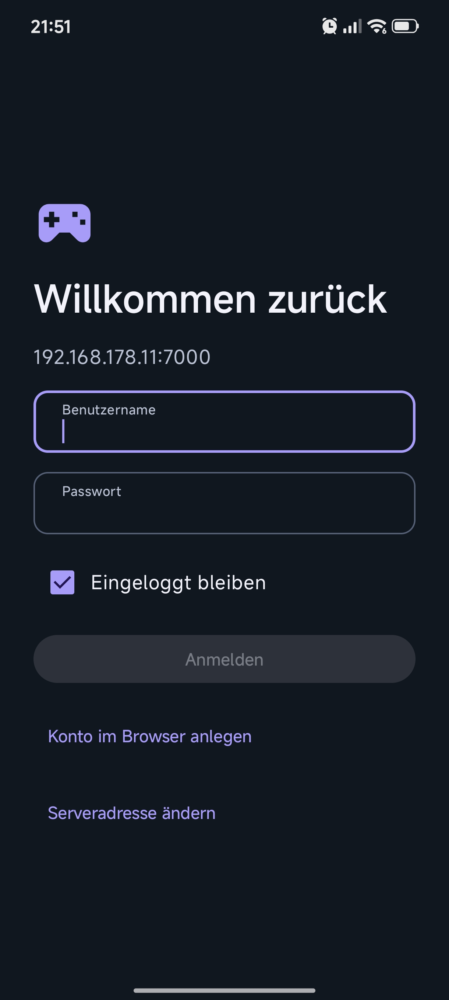</a> | <a href="docs/screenshots/android-sammlung.jpg">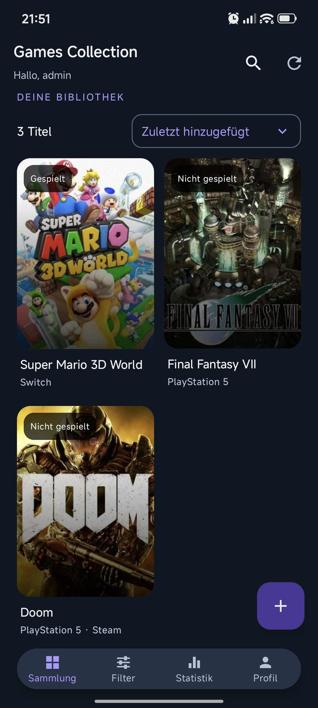</a> | <a href="docs/screenshots/android-igdb-suche.jpg">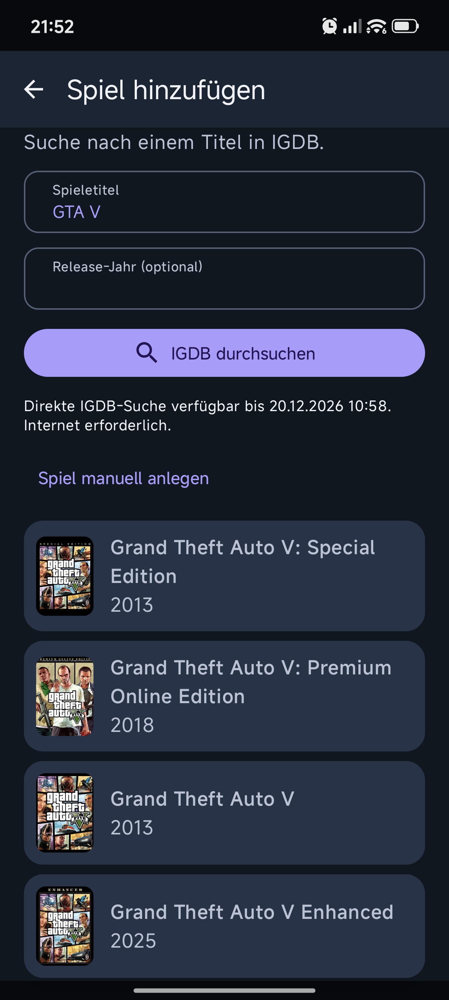</a> |

| Spiel hinzufügen | Statistik |
| --- | --- |
| <a href="docs/screenshots/android-spiel-hinzufuegen.jpg">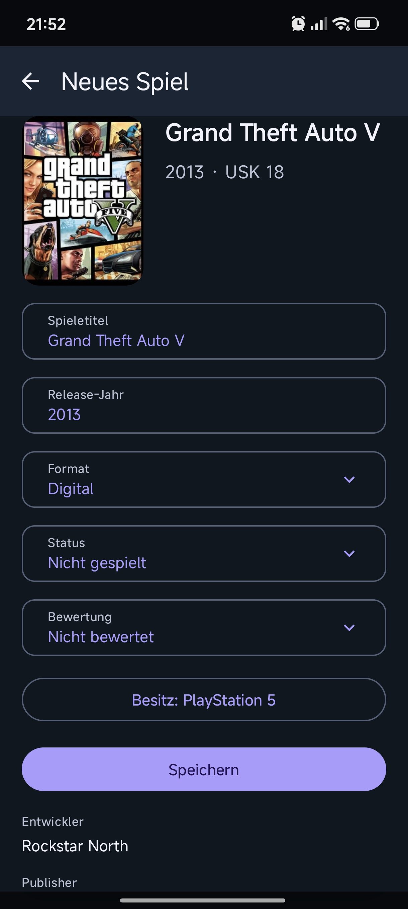</a> | <a href="docs/screenshots/android-statistik.jpg">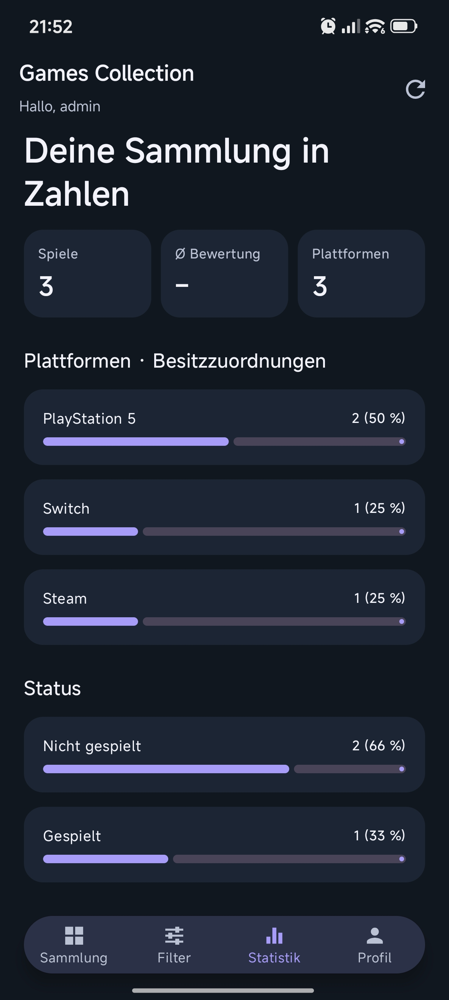</a> |
